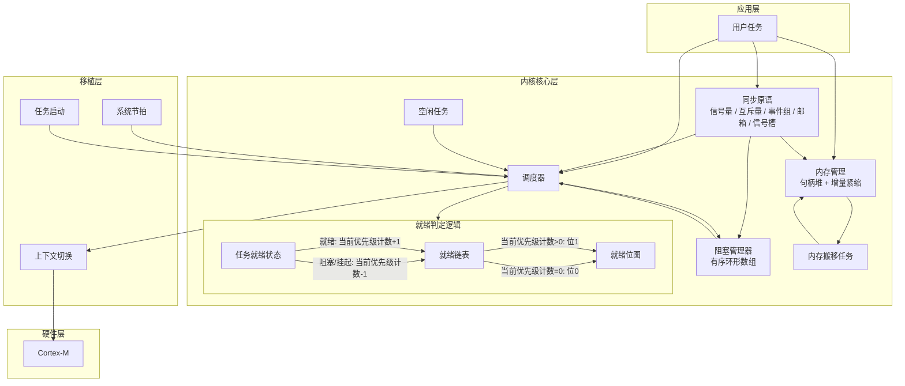
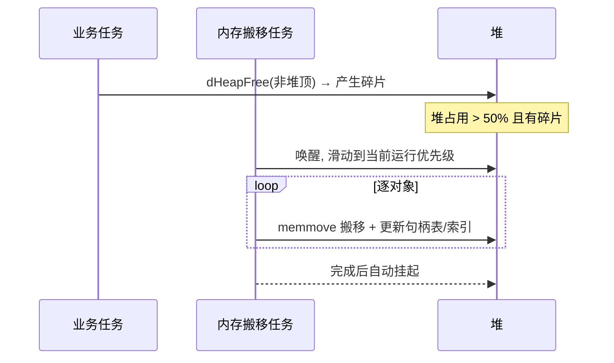

<div align="center">

# 🚪 DooRT

**用 C++ 编写, 面向 Cortex-M 的抢占式实时操作系统内核**

> *LBBDOOR 开发 - 2026-08-31 - V0.1*
>
> 用 C 的简洁对外, 用 C++ 的工程实现. 静态内存, 无动态分配, 句柄安全, 增量紧缩.

[](#)
[](#)
[](#)
[](#)
[](#)
[](#)

</div>

---

## 📑 目录

- [这是什么](#-这是什么)
- [特性一览](#-特性一览)
- [架构总览](#-架构总览)
- [目录结构](#-目录结构)
- [移植与配置](#-移植与配置)
- [快速上手](#-快速上手)
- [调度器](#-调度器)
- [任务管理](#-任务管理)
- [内存管理](#-内存管理)
- [同步与通信原语](#-同步与通信原语)
- [异步信号槽(Qt 式)](#-异步信号槽qt-式)
- [故障处理](#-故障处理)
- [弱符号钩子](#-弱符号钩子)
- [API 速查表](#-api-速查表)
- [注意事项](#-注意事项)

---

## 🚪 这是什么

**DooRT**(Door RTOS)是一个为 **Cortex-M**(如 STM32F429)设计的实时操作系统内核. 它使用 **C++** 实现内部机制, 但对外暴露的是干净的 **C 接口**(所有公开函数以 `extern "C"` 导出), 方便在任意 C/C++ 工程中接入.

它的核心设计理念是:

| 设计主张 | 具体体现 |
|---------|---------|
| **禁止动态分配** | 关闭标准库 `malloc/free`, 编译期直接报错拦截 |
| **静态内核分配** | 内核对象(TCB, 任务队列, 位图, 阻塞表, 信号槽)全部在内核区 `placement new` |
| **间接句柄式堆** | 用户堆对象用 `uint16_t` 句柄访问, 而非裸指针 |
| **增量内存紧缩** | 碎片化时由专用任务逐步搬移对象, 避免堆外泄漏与长期碎片 |
| **完整同步原语** | 信号量 / 互斥量 / 事件组 / 邮箱|
| **实验异步原语**| Qt风格的信号槽使用方法|

> **注意**: DooRT 面向**裸机 / 资源受限**环境, 设计上以"确定性强, 最大化内存利用率"为优先, 而非通用桌面环境.

---

## ✨ 特性一览

**抢占式内核**
- 位图就绪表 + `__builtin_ctz`, O(1) 定位最高优先级
- 同优先级**时间片轮询**
- 基于 PendSV / SVC / SysTick 的裸汇编上下文切换

**任务管理**
- 不允许运行时创建任务和删除任务
- 支持就绪态和挂起态创建
- 运行期调整 / 查询优先级
- 任务可主动delay和主动yield

**延迟阻塞器**
- 有序顺序表, 二分插入
- 表和每个元素均八位对齐
- 插入采用二分查找
- 内存搬运使用短边搬运
- 时间复杂度约`O(log(n) + n/4)`
- 唤醒时间**无符号回绕安全**

**内存管理**
- 句柄位图 + 句柄表 + 地址索引的三级管理
- 增量式内存紧缩任务
- 任务优先级为滑动优先级, 会自动插入到当前正在运行的优先级链表内
- 堆使用率 / 碎片率可实时计算查询

**任务间通信**
- 计数信号量
- 互斥量: **优先级继承** + 递归持有
- 事件组: 32 位标志, 支持"全满足 / 任一满足"
- 邮箱: **主题匹配** + **紧急插队** + 三种**满箱策略**
- Qt 式异步**信号 / 槽**

**健壮性**
- HardFault 中打印现场
- 完整的初始化/内存/任务异常的错误回调
- 弱符号钩子, 方便自定义日志, 节拍与用户初始化

---

## ✨ 架构总览

DooRT 是一个抢占式优先级 RTOS, 整体自下而上分为四层: **硬件层**(Cortex-M4), **移植层**(SysTick / PendSV / SVC / 临界区), **内核核心层**(调度器, 任务队列, 阻塞管理器, 同步原语, 内存管理, 原生任务), **应用层**(用户任务). 其设计有两个核心原则:

- **任务常驻, 只改状态.** 任务创建后固定挂在其优先级的任务队列里, 调度 / 阻塞 / 唤醒过程中任务本身不移动; 就绪与否完全由任务状态码 + 就绪计数 + 优先级位图三者表示.
- **两块内存, 各司其职.** 内核对象在内核区 `placement new`(固定不释放); 用户与同步原语对象在动态句柄堆上分配, 支持增量式内存紧缩.



### 核心调度模型

调度器维护一张**就绪位图**, 每个已用优先级占一位, 表示该优先级当前是否有就绪任务. 完整决策流程:

1. **选优先级**: 用 `__builtin_ctz` 在就绪位图上找到最高的非零位, 即当前最高就绪优先级.
2. **挑任务**: 从该优先级的任务队列遍历, 挑出第一个状态为 `READY` 的任务作为下一个运行对象.
3. **时间片轮转**: 若当前运行任务本就属于最高就绪优先级且状态为 `READY`, 则跳到队尾的下一个任务, 让同优先级任务轮流占用 CPU; 队尾回绕到队头.
4. **切换**: 记录当前/下一任务指针, 触发 PendSV 完成栈切换.

就绪状态由三处**同步维护**:

| 载体 | 含义 |
|------|------|
| 状态码 `dtStatusCode` | 任务当前状态: `READY` / `BLOCKED` / `SUSPENDED` |
| 就绪计数 `readyTask` | 每个优先级队列记录该优先级有几个就绪任务, 任务非就绪则--, 就绪++ |
| 就绪位图 `dksPriorityBitMap` | 当readyTask被减到0时将对应位清 0 , 有一个就绪任务则置1|

关键机制: 任务阻塞或挂起时**只改状态码**, 再把该优先级 `readyTask` 计数减一(归零时清位图); 唤醒时**只改状态码**, 把 `readyTask` 加一并置位图. 这种设计避免了复杂的链表搬移, 且无须频繁更改指针.

### 阻塞与唤醒

- 任务调用延时或等待原语时, 状态改为 `BLOCKED`, 按唤醒时刻 `AwakeTick` **二分插入和短边搬运**阻塞管理器的有序环形数组(平均 `O(log(n) + n/4)` ), 唤醒时刻用无符号比较, 长期运行 tick 回绕也不出错.
- 每次 SysTick 只检查队首是否到期, 若队首到期, 则批量把任务改回 `READY` 并更新计数/位图.
- `SUSPENDED`不进入阻塞管理器, 只能由外部显式唤醒.
- `BLOCKED`阻塞由时间或原语自动解除.

### 上下文切换

- **SysTick**: 每个 tick 调用 `dIncTick`, 检查延时到期, 更新内存搬移任务状态, 然后执行一次调度决策.
- **PendSV**(naked): 保存当前任务 R4-R11, 从下一任务 TCB 恢复 R4-R11, 再由硬件弹出 xPSR/PC/LR/R12/R0-R3 完成切换.
- **SVC**(naked): 启动第一个任务, 从伪造好的初始栈帧进入任务入口(入口先排空该任务的延迟信号回调, 再执行用户函数).
- 临界区用 `cpsid` / `cpsie` 开关全局中断保护, PendSV/SysTick 设为最低中断优先级, 避免打断外设中断.

### 内存模型

内核划分两块固定地址区域:

- **内核区 KernelBlock**: 所有内核对象(TCB, 任务队列, 就绪位图, 阻塞表, 信号槽)用 `placement new` 在此构造, 编译期固定, 运行期不释放.
- **动态句柄堆 Heap**: 用户任务与同步原语对象在此分配, 返回 `uint16_t` 句柄而非裸指针; 每次使用都解析句柄裸指针. 

句柄堆由三级结构管理: **句柄位图**(快速分配空闲句柄 ID), **句柄表**(记录句柄对应的地址与大小), **地址索引**(按地址排序, 供紧缩器定位对象).

增量式内存紧缩器: 当堆占用超过一半且有碎片时触发, 由**内存搬移任务**(跟随当前运行优先级滑动)逐步 `memmove` 搬移对象, 并同步更新句柄表与地址索引, 期间每步关中断保证原子.

### 同步原语

信号量 / 互斥量 / 事件组 / 邮箱 都是**堆上对象**, 通过句柄访问, 每个对象带一张**有界等待表**(默认最多 8 个等待任务):

- 等待时把任务登记进等待表并置 `BLOCKED`(移出就绪计数/位图), 触发一次调度.
- 释放/唤醒时把等待者改回 `READY`(增计数/置位图), 若优先级更高则立即触发切换.
- 互斥量额外带**优先级继承**, 防止高优先级任务被中间优先级任务长时间插队.

### 实验性异步原语
信号槽是本内核唯一的异步原语

- 信号槽需要选中槽函数, 所以信号和槽不允许动态创建, 只允许动态链接
- 每个信号可以链接`DOORT_SIGNAL_PENDING_PER_TASK`个槽函数, 在运行中可以断连槽函数或连接槽函数
- 槽函数可绑定到特定任务，触发时根据当前任务与绑定任务是否一致，选择同步内联执行或异步延迟执行

---

## ✨ 目录结构

```text
DooRT/
├── README.md                                    # 本文档
└── door_rtos/                                       # 内核本体
    ├── Inc/                                              # 头文件(公开 API + 内部接口)
    │   ├── doort.h                                  # ★ 所有对外 C 接口
    │   ├── doort_config.h                       # ★ 内核配置(建议修改的文件)
    │   ├── doort_config_user_type.h      # ★ 注册自定义句柄类型(X-Macro)(建议修改的文件)
    │   ├── doort_task.hpp                      # TCB 定义
    │   ├── doort_kernel_scheduler.hpp
    │   ├── doort_task_blocked.hpp
    │   ├── doort_memory_manage.hpp
    │   ├── doort_memory_handle.hpp   # 句柄宏魔法(_Generic + X-Macro)
    │   ├── doort_bitmap_tool.hpp
    │   ├── doort_port.hpp                     # 移植层
    │   ├── doort_global_state.hpp
    │   ├── doort_fault.hpp
    │   ├── doort_sync_*.hpp                  # 同步原语
    │   ├── doort_async_connect.hpp     # 信号槽
    │   └── doort_native_task.hpp          # 空闲任务 / 内存搬移任务
    └── Src/                                             # 实现
        ├── doort.cpp                                # C API 中转站 + 全局对象
        ├── doort_task.cpp
        ├── doort_kernel_scheduler.cpp
        ├── doort_task_blocked.cpp
        ├── doort_memory_manage.cpp
        ├── doort_memory_move_task.cpp # 内存搬移任务
        ├── doort_async_connect.cpp
        ├── doort_sync_*.cpp
        ├── doort_Interrupt.cpp                  # 中断向量表重写
        ├── doort_Idle_task.cpp                  # 空闲任务
        ├── doort_port.cpp                         # 初始栈帧伪造 + SysTick 配置
        └── doort_fault.cpp
```

>如需改动, **只建议修改 `doort_config.h`和`doort_config_user_type.h`**.

---

## ✨ 移植与配置

所有可调参数集中在 **`doort_config.h`**:

```c
#define DOORT_HEAP_ALLOCATION_ENABLED 0        // 标准库堆分配启用(0=禁止)
#define DOORT_STACK_REUSE_ENABLED     0        // 栈复用启用(预留, 未实现)
#define DOORT_KERNEL_ADDRESS   0xD0000000      // 内核区起始地址
#define DOORT_KERNEL_BLOCK_SIZE 128            // 内核区大小 (KB)
#define DOORT_HEAP_IS_ENABLE   1               // 是否启用堆
#define DOORT_HEAP_BLOCK_SIZE  32              // 静态堆大小 (KB)
#define DOORT_HEAP_OBJECT_NUM  2300            // 堆对象(句柄)数量
#define DOORT_HERP_ADDRESS_FOLLOW_KERNEL 0     // 堆是否紧跟内核区
#define DOORT_HERP_ADDRESS   0xD1000000        // 堆起始地址(若未跟随内核)
#define DOORT_SUGGESTION_MIN_STACK  256        // 建议最小栈 (字节)
#define PHYSICAL_MIN_STACK    64               // 物理最小栈(低于无法存上下文)
#define SPECIAL_PRIORITY_OFFSET 3              // 保留的 3 个内核特权级
#define DOORT_ENABLE_INCREMENTAL_MEMORY_COMPACTOR 1  // 启用增量内存紧缩
#define DOORT_SIGNAL_PENDING_PER_TASK 4        // 每任务延迟信号回调容量
```

> 优先级: 共 `128 + 3` 级. 其中 3 级被内核保留(软件中断 / 硬件中断 / 超级提权), 用户任务可用范围大致为 `-2 ~ 127`.

**关键说明: **
- `DOORT_HEAP_ALLOCATION_ENABLED == 0` 时, `malloc/calloc/realloc/free/strdup/asprintf/vasprintf` 会被宏替换为**编译期报错**. 
- 默认堆分配禁用, 为了避免标准库堆分配和placement new造成混乱, 如果使用不当malloc可能会将placement new构造的内容覆盖掉
- 内核区/堆区是**静态固定地址**, 需要根据芯片实际内存布局调整 `DOORT_KERNEL_ADDRESS` / `DOORT_HERP_ADDRESS`, 避免与可寻址 SRAM 重叠.
- 堆的启用需要额外元数据空间(句柄位图, 句柄表, 地址索引), 内存过小的芯片建议禁用.

---

## ✨ 快速上手

### 1. 在 `main` 中初始化并启动

```c
#include "doort.h"

static dsSemHandle   g_sem;
static dsMutexHandle g_mutex;
static int g_shared = 0;

//用户初始化钩子, 信号量/互斥量等同步原语对象分配在动态句柄堆上
//堆初始化后会自动调用dUserInit进行用户自定义的初始化
//同步原语目前需要创建在堆上, 所以需要在dUserInit中初始化
void dUserInit(void) {
    /* 创建同步原语 */
    g_sem   = dsSemCreate(1, 0);
    g_mutex = dsMutexCreate();
}

/* ---- 任务 1: 生产者 ---- */
void producer_task(void *arg) {
    (void)arg;
    while (1) {
        dsSemGive(g_sem);      /* 释放信号量 */
        dTaskDelay(100);       /* 延时 100 个 tick */
    }
}

/* ---- 任务 2: 消费者 ---- */
void consumer_task(void *arg) {
    (void)arg;
    while (1) {
        if (dsSemTake(g_sem)) {
            dsMutexLock(g_mutex);
            g_shared++;        /* 临界区 */
            dsMutexUnlock(g_mutex);
        }
    }
}

/* ---- 任务元数据结构体 ---- */
struct dTaskParams p1 = { 
    .dtFunc = producer_task, //任务函数
    .dtPriority = 10,               //任务优先级
    .dtStackSize = 512,         //任务栈大小
    .dtHandle = 0,                //任务句柄, 0或NULL, dTaskCreate会自动填入内容
    .dtParameters = 0          //任务启动时参数
    };
struct dTaskParams p2 = { 
    .dtFunc = consumer_task, 
    .dtPriority = 20,
    .dtStackSize = 512, 
    .dtHandle = 0, 
    .dtParameters = 0 
    };

int main(void) {
    /* 1. 配置时钟与节拍 */
    dInitSystemClock(180000000UL);  /* 主时钟180 MHz */
    dInitSysTick(1000);                        /* 1000us一个 tick */

    dTaskCreate(&p1);//传入任务元数据
    dTaskCreate(&p2);

    /* 3. 启动调度器(永不返回) */
    dStartScheduler();

    return 0; /* 不会执行到这里 */
}
```

### 2. 实现弱符号钩子(若不定义则用默认空实现)

```c
/* 日志输出: 用户自行实现, 内核通过 dLog 打印信息 */
void dLog(const char *fmt, ...) {
    /* 例如转发到串口 / HAL_UART */
}

/* 节拍回调: SysTick 中断里调用, 可在此维护 HAL tick */
void dIncTick(void) {
    /* 例如使用默认HAL时钟: HAL_IncTick(); */
}

/* 用户初始化: 调度器在初始化完成所有内核对象时调用一次
   注意: 动态堆此时已就绪, 分配在堆上的同步原语(信号量/互斥量/事件组/邮箱等)必须在这里创建 */
void dUserInit(void) {
    /* 创建同步原语 */
}
```

> **注意**: 
> 任务必须在 `dStartScheduler()` 之前通过 `dTaskCreate` 注册, 调度器启动时会统一把它们挂到对应的优先级任务队列.
> 不允许动态创建任务, 因为可能踩坏堆

---

## ✨ 调度器

DooRT 采用**基于位图的抢占式优先级调度** + 同优先级**时间片轮转**:

- 每个已用优先级对应一个**任务队列**(`dTaskQueueHead`), 任务以双向链表常驻挂载, 不随阻塞/就绪移动.
- 就绪与否由任务**状态码 + 就绪计数(`readyTask`) + 优先级位图(`dksPriorityBitMap`)** 三者共同表示.
- `dksGetHighestReadyIndex()` 借助 `__builtin_ctz` 定位**最高就绪优先级**, 再遍历该优先级队列挑出第一个就绪任务运行.
- 若当前任务就绪且与最高就绪优先级相同, 则跳到下一个任务, 实现**时间片轮转**; 队尾回绕到队头.
- 任务阻塞/挂起时**只改状态码**并减计数/清位图, 任务本身留在队列; 唤醒时**只改状态码**并增计数/置位图, 触发重新调度.

### 延迟阻塞管理器

`dTaskDelay` 等延时任务进入 `dTaskBlockedManager` 维护的**顺序表**:

- 按唤醒时刻 `AwakeTick = 当前tick + delay` 排序.
- 插入采用**二分查找**定位 + 向更短一侧搬移, 平均复杂度约为 `O(log(n) + n/4)`.
- 唤醒时刻使用无符号比较(自动回绕), 长期运行 tick 溢出也不会出错.
- 每次 SysTick 只检查队首是否到期(`dtbTaskDue()`), 到期才批量解除阻塞.

---

## ✨ 任务管理

任务由 `dTaskControlBlock`(TCB)表示, 字段包括栈指针, 栈底/栈大小, 入口函数, 前后向链表指针, 唯一任务 ID, 状态码与优先级等.

**任务状态: **

| 状态 | 宏 | 说明 |
|------|----|------|
| 就绪 | `DOORT_TASK_STATUS_READY` | 可被调度运行 |
| 阻塞 | `DOORT_TASK_STATUS_BLOCKED` | 等待延时或同步原语 |
| 挂起 | `DOORT_TASK_STATUS_SUSPENDED` | 显式挂起, 不参与调度 |

**任务相关 API: **

| 函数 | 作用 |
|------|------|
| `dTaskCreate(&params)` | 创建并注册一个就绪任务 |
| `dTaskCreateSuspend(&params)` | 创建但初始为挂起态 |
| `dStartScheduler()` | 启动调度器(永不返回) |
| `dTaskSuspend()` | 挂起当前任务 |
| `dTaskDelay(tick)` | 当前任务延时阻塞 |
| `dTaskYield()` | 主动让出 CPU |
| `dTaskTargetSuspend(handle)` | 挂起指定任务 |
| `dTaskTargetReady(handle)` | 唤醒指定任务 |
| `dTaskSetPriority(handle, prio)` | 运行期调整优先级 |
|调试函数|-|
| `dTaskGetPriority(handle)` | 查询优先级 |
| `GetTaskID()` / `GetTaskStatu()` | 查询当前任务 ID / 状态 |
| `GetCurrentReadyTaskCount()` | 当前优先级就绪任务数 |

>任务入口函数签名: `void (*dtFunction)(void* dtParameters)`, 参数通过 `dtParameters` 传入.

---

## ✨ 内存管理

DooRT 将内存划分为两个独立区域:

```text
┌───────────────────────────────┐
│  内核区 KernelBlock                                                                                 │
│  起始地址DOORT_KERNEL_ADDRESS                                                       │
│  存放: TCB / 任务队列 / 位图 / 阻塞表 / 信号槽等                                   │
│  分配方式: placement new(编译期固定对象, 无释放)                               │
├───────────────────────────────┤
│  动态堆 Heap                                                                                           │
│  起始地址DOORT_HERP_ADDRESS                                                          │
│  存放: 用户堆对象, 同步原语对象等                                                        │
│  分配方式: 句柄式分配 + 增量内存紧缩                                                  │
└───────────────────────────────┘
```

### 内核区(KernelBlock)

- 所有内核对象通过 `dmKernelPlacementNew` / `dmKernelPlacementNewArray` 在固定地址上构造.
- 分配时使用4 / 8 字节对齐, 地址安全检查(越界触发内存访问违规陷阱).
- 启动时若内核区空间不足, 触发 `dfInitializationFault_DispatchQueueInitializeFailed()`.

### 动态堆(句柄式分配)

堆对象**不直接返回裸指针**, 而是返回一个 `uint16_t` 句柄 ID:

- **句柄位图**(`dmHandleBitMap`): 快速找到空闲句柄 ID.
- **句柄表**(`dmObjectHandleHead`): 记录每个句柄对应的地址与大小.
- **地址索引**(`dmAddressIndex`): 按地址排序, 供紧缩器定位对象.

```c
uint16_t dHeapAlloc(size_t size);                   /* 分配, 返回句柄 ID(UINT16_MAX 表示失败) */
void*     dHandleDereference(uint16_t id);    /* 句柄 -> 裸地址 */
void      dHeapFree(uint16_t id);                   /* 按句柄释放 */
uint8_t  dHeapUsagePercent(void);              /* 堆使用率 */
uint8_t  dHeapFragPercent(void);                 /* 碎片率(已用区域中空洞占比) */
```

### 类型化句柄宏魔法(X-Macro + `_Generic`)

`doort_memory_handle.hpp` 通过 X-Macro(`DOORT_TYPES_LIST`)批量生成**类型化句柄**:

```c
/* 在 doort_config_user_type.h 注册类型 */
#define DOORT_TYPES_LIST(X) \
    X(int) X(float) X(MyStruct) ...                                       /* 可追加自定义类型 */

/* 自动生成: 句柄结构体 + Resolve + Create/Destroy */
MyStruct_dObjectHandle h = MyStruct_Create();           /* 创建对象 */
MyStruct *p = GET(h);                                                    /* _Generic 解引用 */
h.id = ...;                                                                         /* 句柄本质是 uint16_t id */
MyStruct_Destroy(h);                                                      /* 销毁 */
```

- `type##_dObjectHandle`: 每个类型一个句柄结构体(内含 `uint16_t id`).
- `type##_Resolve` / `GET(h)`: `_Generic` 根据类型自动选择解析函数, 返回裸地址.
- `type##_Create` / `type##_CreateArray` / `type##_Destroy`: 类型化创建/销毁.
- 由于句柄是 ID, **在内存被搬移后依然有效**, 这正是抗压缩的关键.

### 增量式内存紧缩器

当堆使用率超过 **50%** 且存在碎片时触发紧缩:

- 由专用**内存搬移任务**(`dntMemoryMoveTask()`)逐步执行.
- 该任务**没有固定优先级**, 会**跟随当前运行优先级滑动**: 平时挂起, 有紧缩需求才唤醒, 避免打扰业务任务.
- 每步用 `memmove` 把对象向堆底搬移, 并**同步更新句柄表与地址索引**.
- 搬移过程按步原子, 防止其他任务读到"搬了一半"的对象.
- 任何同步原语使用时都是**每次现解析句柄**(`dmhHandleDereference`), 因此对象被搬走后依然能拿到正确地址.
- - 待优化, 未来将实现私有化对象和搬运锁, 避免持续性关中断



> 该功能由 `DOORT_ENABLE_INCREMENTAL_MEMORY_COMPACTOR` 宏控制. 开启后内存搬移任务会占用少量运行时间.

---

## ✨ 同步与通信原语

所有同步原语对象都分配在**动态堆**上, 返回句柄(`uint16_t`), 并在使用时**每次现解析**以抗压缩. 每个原语带**有界等待表**(默认最多等待 8 个任务, 可通过配置宏覆盖).

### 信号量 `dsSem*`

```c
dsSemHandle dsSemCreate(uint16_t maxCount, uint16_t initCount);
void   dsSemDelete(dsSemHandle h);
bool   dsSemGive(h);        /* 释放: 唤醒队首等待者, 无等待者则累加计数 */
bool   dsSemTake(h);        /* 获取: 有计数则消费, 否则阻塞 */
bool   dsSemTryTake(h);     /* 非阻塞获取 */
```

### 互斥量 `dsMutex*`(带优先级继承)

```c
dsMutexHandle dsMutexCreate(void);
bool dsMutexLock(h);        /* 加锁: 空闲则占有, 否则阻塞 */
bool dsMutexTryLock(h);     /* 非阻塞加锁 */
bool dsMutexUnlock(h);      /* 解锁: 把锁转交给队首等待者 */
void dsMutexDelete(h);
```

- **优先级继承**: 当高优先级任务等待一个低优先级持有者时, 持有者被临时提升到等待者优先级, 防止中间优先级插队; 解锁时恢复原始优先级.
- **递归持有**: 同一任务可多次加锁, 需对称解锁; 递归锁自动转交等待者.

### 事件组 `dsEvent*`

```c
dsEventHandle dsEventCreate(void);
bool dsEventSet(h, uint32_t flags);          /* 置位事件标志 */
bool dsEventClear(h, uint32_t flags);       /* 清除事件标志 */
bool dsEventWait(h, flags, waitAll);         /* 阻塞等待, waitAll=全满足/任一满足 */
bool dsEventTryWait(h, flags, waitAll);    /* 非阻塞检查 */
uint32_t dsEventGetFlags(h);                  /* 读取当前标志 */
void dsEventDelete(h);
```

### 邮箱 `dsPost*`(带主题 / 紧急 / 溢出策略)

```c
dsPostHandle dsPostCreate(uint16_t capacity, uint8_t overflowPolicy);
bool     dsPostSend(h, mailId, subject, urgent);
bool     dsPostTrySend(h, mailId, subject, urgent);
bool     dsPostSendWait(h, mailId, subject, urgent, ticks);
uint16_t dsPostRecv(h);
uint16_t dsPostTryRecv(h);
uint16_t dsPostRecvWait(h, subject, ticks);   /* 按主题接收 */
uint16_t dsPostCount(h);
void     dsPostDelete(h);
```

- **零拷贝**: 邮箱槽位只搬运**邮件句柄**, 邮件实体留在堆上, 接收后由接收方按句柄解引用/释放.
- **主题**: 每封邮件带 `subject`; 接收可用 `DSP_SUBJECT_ANY` 通配匹配任意主题, 实现"分类收发".
- **紧急邮件**: `urgent=true` 时插队到队首, 优先被取出.
- **满箱策略**:
| 宏 | 行为 |
|----|------|
| `DSP_OVERFLOW_BLOCK` | 阻塞发送者, 等待空位 |
| `DSP_OVERFLOW_DROP_OLDEST` | 丢弃最旧的邮件 |
| `DSP_OVERFLOW_DROP_NEWEST` | 丢弃最新的邮件 |

- 超时宏: `DSP_WAIT_FOREVER`(无限等待)/ `DSP_NO_WAIT`(不等待).

---

## ✨ 异步信号槽(Qt 式)

`daConnect*` 提供 **Qt 风格**的异步信号/槽机制:

```c
daSignalHandle sig = daConnectCreate(slotCapacity);              /* 创建信号 */
daSlotHandle   sl  = daConnectSlot(task, mySlotFn, ctx);           /* 注册槽(绑定到某任务上下文) */
daConnect(sig, sl);                                                                     /* 连接 */
daConnectTrigger(sig, arg);                                                       /* 触发 */
daDisconnect(sig, sl);                                                                 /* 断开 */
```

- 信号触发时, 遍历已连接的槽.
- 若槽绑定的任务就是**当前触发任务** -> 槽函数**内联立即执行**.
- 否则 -> 把调用**延迟入队**到目标任务的每任务 pending 队列(容量 = `DOORT_SIGNAL_PENDING_PER_TASK`宏, 默认 4), 在该任务下一次切换进入/启动时排空执行.
- **零动态分配**: pending 队列是 TCB 内嵌的静态数组, 容量满则丢弃该次触发(不产生内存分配).

>这实现了"跨任务异步回调", 且不引入额外堆分配, 非常适合事件驱动的嵌入式场景.

---

## ✨ 故障处理

DooRT 内置多级错误陷阱(`doort_fault.cpp`), 用于在裸机环境下尽早暴露问题:

| 陷阱 | 触发场景 |
|------|---------|
| `dfInitializationFault_TickTimeTooShort` | 节拍太短, 调度器会陷入中断风暴 |
| `dfInitializationFault_TaskStackTooSmall` | 任务栈小于物理最小栈, 无法保存上下文 |
| `dfInitializationFault_UnsupportedPriority` | 使用了超出范围的任务优先级 |
| `dfInitializationFault_NoTasks` | 启动调度器时没有任何有效任务 |
| `dfInitializationFault_DispatchQueueInitializeFailed` | 内核区空间不足 |
| `dfInitializationFault_FailedToCreateTask` | 创建任务失败(并打印剩余/所需内存) |
| `dfTaskFault_UnexpectedReturn` | 任务函数意外返回(RTOS 任务不应 return) |
| `dfMemoryFault_AccessViolation` | 内存越界访问 |

---

## ✨ 弱符号钩子

内核以 `__attribute__((weak))` 提供默认实现, 用户可自行覆盖:

| 钩子 | 作用 | 默认行为 |
|------|------|---------|
| `dLog(format, ...)` | 内核日志输出 | 空实现 |
| `dIncTick()` | SysTick 节拍回调 | 空实现 |
| `dUserInit()` | 调度器启动时用户初始化 | 空实现 |
| `dntIdleTask` | 空闲任务函数(最低优先级) | `while(1)` |

在任意源文件中定义同名强符号即可替换弱符号, 例如:

```c
/* 用户文件: 覆盖 dLog, 把内核日志转到串口 */
#include <stdarg.h>
void dLog(const char *fmt, ...) {
    va_list ap; va_start(ap, fmt);
    /* vsnprintf + UART 输出 */
    va_end(ap);
}
```

---

## ✨ API 速查表

### 初始化 / 启动

| 函数 | 说明 |
|------|------|
| `dInitSystemClock(coreFreq)` | 设置内核时钟频率(Hz) |
| `dInitSysTick(sysTickUs)` | 设置系统节拍周期(微秒) |
| `dStartScheduler()` | 启动调度器, 永不返回 |

### 任务

| 函数 | 说明 |
|------|------|
| `dTaskCreate(&params)` | 创建任务 |
| `dTaskCreateSuspend(&params)` | 挂起创建任务 |
| `dTaskSuspend()` / `dTaskDelay(t)` / `dTaskYield()` | 自身挂起 / 延时 / 让出 |
| `dTaskTargetSuspend(h)` / `dTaskTargetReady(h)` | 挂起 / 唤醒指定任务 |
| `dTaskSetPriority(h, p)` / `dTaskGetPriority(h)` | 设置 / 查询优先级 |
| `GetTaskID()` / `GetTaskStatu()` / `GetCurrentReadyTaskCount()` | 查询当前任务信息 |
| `GetBlockSeqList()` | 获取阻塞序列列表 |

### 堆

| 函数 | 说明 |
|------|------|
| `dHeapAlloc(size)` / `dHeapFree(id)` | 分配 / 释放(句柄) |
| `dHandleDereference(id)` | 句柄 → 裸地址 |
| `dHeapUsagePercent()` / `dHeapFragPercent()` | 使用率 / 碎片率 |
| `TestCompaction()` | 手动触发一次内存紧缩 |

### 信号量 `dsSem`

`Create(max, init)`, `Delete`, `Give`, `Take`, `TryTake`

### 互斥量 `dsMutex`

`Create`, `Delete`, `Lock`, `TryLock`, `Unlock`

### 事件组 `dsEvent`

`Create`, `Delete`, `Set`, `Clear`, `Wait`, `TryWait`, `GetFlags`

### 邮箱 `dsPost`

`Create(capacity, policy)`, `Delete`, `Send`, `TrySend`, `SendWait`, `Recv`, `TryRecv`, `RecvWait`, `Count`

### 异步信号槽 `daConnect`

`Create(slotCapacity)`, `Slot(task, fn, ctx)`, `Connect`, `Disconnect`, `Trigger`

> 完整声明见 **`door_rtos/Inc/doort.h`**

---

## ✨ 注意事项

- **优先级范围**: 任务优先级不要超过 `-2 ~ 127`, 否则触发 `dfInitializationFault_UnsupportedPriority`.
- **任务栈**: 建议不小于 `DOORT_SUGGESTION_MIN_STACK`(256 字节), 低于 `PHYSICAL_MIN_STACK`(64 字节)无法保存完整上下文, 直接报错.
- **内存地址**: 务必按芯片实际可寻址空间配置 `DOORT_KERNEL_ADDRESS` 与 `DOORT_HERP_ADDRESS`, 避免重叠.
- **同步原语等待表有界**: 默认每个原语最多容纳 8 个等待者, 超出返回失败(可通过 `DOORT_SYNC_*_MAX_WAITERS` 覆盖).
- **异步信号槽 pending 队列有界**: 容量满时该次触发会被丢弃(零动态分配设计使然).
- **任务创建时机**: `dTaskCreate` 需在 `dStartScheduler()` 之前调用.

---

<div align="center">

**DooRT, 用 C++ 构建的 Cortex-M 实时内核**

*© LBBDOOR - 2026-07 - V0.1*

🚪 *Keep the door open for real-time.*

</div>
